<!--
Nguon cua BaoCao_Nhom.docx. Build: node scripts/build_bao_cao_nhom.cjs
Cu phap rieng:
  ::cover, ::toc, ::lot, ::lof, ::refs, ::abbr  khoi dac biet
  # CHUONG ...      tieu de chuong (sang trang moi)
  #* TIEU DE        tieu de khong danh so (sang trang moi, van vao muc luc)
  ## / ###          muc, tieu muc
  $$ cong thuc || (2.1)     phuong trinh, so o le phai
     hinh, chu thich nam duoi
  TABLE Bảng 3.1. Chu thich  + cac dong | a | b |   bang, chu thich nam tren; dong dau la tieu de cot
  TABLE -                   bang khong chu thich; trong o, " " xuong dong, "- " gach dau dong
  ::sign Dong dam; (dong nghieng); Ten 1; Ten 2   khoi ky ten lech phai
  #* o phan dau la tieu de co 18 (cam doan, cam on...); sau chuong 1 la section moi co header rieng
  [@key] hoac [@a; @b]       trich dan, so thu tu lay tu danh muc trong script
  [[...]]                   cho nhom tu dien (to vang)
-->

::cover

#* LỜI CAM ĐOAN

Nhóm tôi xin cam đoan đây là kết quả thực hiện của riêng nhóm dưới sự hướng dẫn của [[Thầy/Cô]] Ngô Dương Hà. Các số liệu và kết quả nêu trong báo cáo là do nhóm chạy thực tế trên hệ thống của đồ án.

Các thông tin, tài liệu tham khảo dùng trong báo cáo đều đã được ghi rõ nguồn trong phần Tài liệu tham khảo.

Nếu có bất kỳ sai phạm nào trong lời cam đoan này, nhóm tôi xin hoàn toàn chịu trách nhiệm.

::sign Sinh viên thực hiện đồ án; _Ký và ghi rõ họ tên; Nguyễn Xuân Định; Hồ Ngọc Phương Như

#* LỜI CẢM ƠN

Nhóm xin gửi lời cảm ơn chân thành đến [[Thầy/Cô]] Ngô Dương Hà, giảng viên học phần Nhập môn Big Data, đã hướng dẫn và góp ý cho nhóm trong suốt quá trình thực hiện đề tài "Phân tích dữ liệu nhật ký hệ thống để phát hiện bất thường".

Nhóm cũng cảm ơn Khoa Công nghệ Thông tin, Trường Đại học Công Thương TP. HCM đã tạo môi trường học tập để nhóm thực hiện đồ án.

Do thời gian và kiến thức còn hạn chế nên báo cáo khó tránh khỏi thiếu sót. Nhóm mong nhận được góp ý để hoàn thiện hơn.

::sign Nhóm sinh viên thực hiện; Nguyễn Xuân Định; Hồ Ngọc Phương Như

#* BẢNG PHÂN CÔNG CÔNG VIỆC

TABLE -
| Tên thành viên | Nhiệm vụ | Mức độ hoàn thành |
| Nguyễn Xuân Định | - Log contract và traffic simulator có nhãn   - Ingest log NASA và log mô phỏng vào bronze, silver   - Trích xuất đặc trưng theo cửa sổ thời gian bằng Spark   - Huấn luyện KMeans, chấm điểm CBLOF, so sánh và đánh giá mô hình | [[....]] |
| Hồ Ngọc Phương Như | - Data lake trên HDFS   - Đưa dữ liệu sang Elasticsearch   - Streaming simulator và phát hiện bất thường thời gian thực   - Dashboard Kibana và luật cảnh báo   - Hướng dẫn vận hành | [[....]] |

::toc

::abbr

::lof

::lot

# CHƯƠNG 1. GIỚI THIỆU ĐỀ TÀI

## 1.1 Bối cảnh và bài toán

Mỗi khi có một request HTTP gửi tới máy chủ web thì máy chủ sẽ ghi lại một dòng access log, trong đó có thời điểm, địa chỉ client, phương thức, đường dẫn, mã trạng thái và dung lượng phản hồi. Nếu chỉ nhìn một dòng log thì gần như không biết được gì nhiều. Các hành vi bất thường như dò đường dẫn [@owasp_forced], thử mật khẩu [@owasp_brute], chèn SQL [@owasp_sqli] hay là flood làm quá tải dịch vụ [@owasp_dos] thì phải nhìn nhiều request của cùng một nguồn trong một khoảng thời gian mới thấy được. Khi lượng log lớn thì không thể ngồi đọc từng dòng bằng tay được nữa.

Theo khảo sát của He và cộng sự về phân tích log tự động [@he2021] thì log thường là văn bản bán cấu trúc, muốn dùng để phát hiện bất thường thì phải phân tích cú pháp nó thành dạng có cấu trúc trước. Đồ án của nhóm cũng làm theo hướng này, đầu tiên là đọc log thành bảng có cột rõ ràng, sau đó tóm tắt hành vi của từng nguồn theo cửa sổ thời gian thành vector đặc trưng, rồi dùng phân cụm để chấm điểm xem mỗi cửa sổ khác thường tới mức nào.

Nhóm chọn bối cảnh là một trang báo điện tử có tầng cache nằm phía trước cơ sở dữ liệu. Hai trường article_id và cache_status với giá trị HIT hoặc MISS trong log là để mô phỏng trang đọc bài viết này. Trong hệ thống thì không có cache thật, hai trường này chỉ là dữ liệu để làm đặc trưng thôi.

## 1.2 Mục tiêu và phạm vi

Mục tiêu của đồ án là xây dựng một quy trình lưu trữ, xử lý và khai thác log bằng công nghệ Big Data, đi từ log thô cho tới cảnh báo hiện lên trên dashboard. Đầu ra gồm có dữ liệu đã làm sạch, đặc trưng theo cửa sổ thời gian, điểm bất thường, model đã đóng gói, dashboard thống kê lỗi và cảnh báo. Cảnh báo phải truy vết lại được, tức là biết client nào bất thường, ở cửa sổ nào, do tín hiệu gì và luật cảnh báo có chạy hay không.

Tất cả các job đều chạy trên cụm Spark 3.5.8 [@zaharia2016] ở chế độ standalone, cụm có một master và một worker 4 lõi. HDFS dùng bản Hadoop 3.2.1 với một NameNode và một DataNode. Elasticsearch và Kibana bản 8.19.14 thì chạy một node. Toàn bộ được dựng bằng Docker Compose trên một máy. Môi trường này là để học tập và demo, nhóm không làm thực nghiệm hiệu năng trên nhiều máy và cũng không làm kiến trúc có tính sẵn sàng cao.

## 1.3 Dữ liệu sử dụng

Đồ án dùng hai nguồn dữ liệu bổ trợ cho nhau, được tóm tắt ở Bảng 1.1. Log NASA tháng 7/1995 [@nasa] là log thật nên có nhiễu và có lỗi định dạng thật, nhưng mà không có nhãn tấn công. Còn simulator của nhóm thì sinh ra log có nhãn, trộn traffic bình thường với bốn kiểu tấn công, dùng để đo precision và recall ra con số cụ thể. Nhãn chỉ dùng để đánh giá chứ không đưa vào mô hình.

TABLE Bảng 1.1. Hai nguồn dữ liệu của đồ án
| Thuộc tính | Log NASA | Log mô phỏng |
| Nguồn | Máy chủ WWW của NASA Kennedy Space Center | generator/simulate.py của nhóm |
| Định dạng | Common Log Format, file nén | JSONL theo Log Contract v1 |
| Số trường | 7 trường CLF | 16 trường |
| Quy mô | 1.891.715 dòng, 01/07 – 28/07/1995 | 1.065.283 dòng, 24 giờ ngày 10/01/2026 |
| Nhãn | Không có | is_anomaly, anomaly_label gồm brute_force, sqli, scan, ddos |
| Dùng để | Kiểm tra pipeline trên log thật, tìm cửa sổ đáng điều tra | Huấn luyện, đo precision/recall/F1, demo thời gian thực |

## 1.4 Đối chiếu với yêu cầu đề tài

Đề tài số 13 trong kế hoạch môn học yêu cầu phải có năm thành phần. Bảng 1.2 ghi lại phần nào của hệ thống đáp ứng thành phần nào và được trình bày chi tiết ở mục nào.

TABLE Bảng 1.2. Thành phần đáp ứng yêu cầu đề tài
| Yêu cầu | Thành phần trong hệ thống | Mục |
| Dữ liệu log từ máy chủ, ứng dụng hoặc mạng | Access log NASA và log simulator của máy chủ web | 1.3, 3.2 |
| Lưu trữ trên HDFS hoặc Elasticsearch | HDFS /lake tầng bronze, silver, gold và 5 index Elasticsearch | 3.3, 3.7 |
| Spark xử lý và trích xuất đặc trưng | Job ingest, build_features, Structured Streaming trên cụm standalone | 3.2, 3.4, 3.6 |
| Phân cụm hoặc phát hiện bất thường | KMeans và BisectingKMeans, chấm điểm CBLOF, ngưỡng p99 | 2.5, 2.6, 3.5, 4.2, 4.4 |
| Dashboard thống kê lỗi và cảnh báo | Hai dashboard Kibana, luật cảnh báo, Trung tâm giám sát | 3.8 |

# CHƯƠNG 2. CƠ SỞ LÝ THUYẾT VÀ CÔNG NGHỆ ÁP DỤNG

## 2.1 Access log và Common Log Format

Log NASA được ghi theo Apache Common Log Format, viết tắt là CLF [@httpd_logs]. Mỗi dòng gồm host, hai trường định danh thường để trống, thời điểm có múi giờ, dòng request nằm trong ngoặc kép, mã trạng thái và số byte trả về. Ví dụ: 199.72.81.55 - - [01/Jul/1995:00:00:01 -0400] "GET /history/apollo/ HTTP/1.0" 200 6245.

Mã trạng thái 2xx là thành công, 3xx là chuyển hướng hoặc dùng bản cache, 4xx là lỗi phía yêu cầu như 404 là không tìm thấy, còn 5xx là lỗi phía máy chủ [@rfc9110]. Một request bị 404 thì là chuyện bình thường, nhưng nếu tỷ lệ 404 cao mà còn đi kèm nhiều đường dẫn khác nhau trong thời gian ngắn thì mới là dấu hiệu dò quét.

Log của simulator thì theo Log Contract v1 do nhóm tự đặt, gồm 16 trường, ghi ở dạng JSONL tức là mỗi dòng là một đối tượng JSON. Ngoài các trường giống CLF thì còn có latency, trạng thái cache HIT/MISS, user-agent, session và hai trường nhãn là is_anomaly và anomaly_label. Thời điểm ts lúc nào cũng là chuỗi ISO 8601 UTC, chính xác tới millisecond.

## 2.2 Lưu trữ phân tán với HDFS

HDFS chia file thành các block rồi phân phối các block này lên các DataNode. NameNode thì quản lý namespace, thông tin file và vị trí của block, còn DataNode là nơi lưu và trả dữ liệu [@hdfs_arch; @shvachko2010]. Khi cụm có nhiều DataNode thì replication giúp có nhiều bản sao của dữ liệu. Kích thước block hay dùng của HDFS là 128 MB [@hdfs_arch]. Trong đồ án thì chỉ có một DataNode nên replication được đặt là 1, còn block size vẫn để 128 MB.

Data lake được chia thành ba tầng là bronze, silver và gold theo mẫu kiến trúc medallion, càng lên tầng sau thì dữ liệu càng sạch và có cấu trúc hơn [@medallion]. Tầng bronze giữ dữ liệu đầu vào, tầng silver lưu Parquet sau khi làm sạch, còn tầng gold lưu đặc trưng, điểm và cảnh báo. Dữ liệu được partition theo dt=YYYY-MM-DD/hour=HH để lọc theo thời gian cho dễ. Parquet là định dạng file lưu theo cột [@parquet] nên hợp với các truy vấn phân tích mà chỉ cần đọc một vài cột.

## 2.3 Apache Spark và Structured Streaming

Apache Spark là engine xử lý dữ liệu phân tán, có thể dùng chung một API DataFrame cho cả SQL, học máy và xử lý luồng [@zaharia2016]. Spark MLlib có sẵn các bước biến đổi đặc trưng và các thuật toán phân cụm mà đồ án dùng tới [@spark_features; @spark_clustering].

Structured Streaming xử lý dữ liệu mới theo từng micro-batch và dùng chung biểu thức DataFrame giống như batch [@spark_ss; @armbrust2018]. Ở update mode thì mỗi micro-batch sẽ phát ra các cửa sổ có thay đổi [@spark_ss]. Watermark dùng để giới hạn trạng thái phải giữ và để biết dữ liệu nào đến quá trễ, chứ watermark không phải là cam kết về độ trễ của cảnh báo. Structured Streaming không hỗ trợ phép distinct trên dữ liệu luồng [@spark_ss], vì vậy các hàm đặc trưng mà batch và streaming dùng chung đều phải dùng approx_count_distinct.

Checkpoint lưu lại tiến độ đọc file và trạng thái aggregation [@spark_ss]. Theo hướng dẫn của Spark thì file phải được đưa vào thư mục nguồn một cách nguyên tử [@spark_ss], nên simulator sẽ ghi ra file tạm trước rồi mới rename, như vậy Spark không đọc phải file đang ghi dở.

## 2.4 Đặc trưng theo cửa sổ thời gian

Đơn vị để phân tích là một cặp gồm nguồn và cửa sổ 5 phút. Với simulator thì nguồn là IP, còn với NASA thì nguồn là IP hoặc hostname. Mỗi cặp như vậy được tóm tắt lại thành một vector đặc trưng. Gom như vậy thì hàng triệu dòng log sẽ thành vài trăm nghìn bản tóm tắt hành vi, và có thể đem các nguồn ra so sánh với nhau.

Có 11 CORE_FEATURES tính được trên cả NASA lẫn simulator. Đó là n_req là số request, burst_rate là tốc độ request, n_distinct_paths là số đường dẫn khác nhau, ratio_4xx, ratio_5xx, ratio_404, ratio_post, ratio_sus_path là tỷ lệ đường dẫn có chứa payload SQLi hoặc trỏ vào vùng nhạy cảm, ratio_static là tỷ lệ request tải css, js và ảnh, cùng với mean_bytes và max_bytes. Tốc độ request được tính theo công thức (2.1):

$$ burst_rate = n_req / (t_cuối − t_đầu + 1) || (2.1)

Trong đó n_req là số request của nguồn trong cửa sổ, t_đầu và t_cuối là thời điểm tính bằng giây của request đầu tiên và request cuối cùng trong cửa sổ, burst_rate có đơn vị là request/giây. Nhóm cộng thêm 1 giây để mẫu số không bị bằng 0 khi cửa sổ chỉ có một request. Nhóm dùng khoảng thời gian thực tế chứ không chia cứng cho 300 giây, vì một đợt flood dồn trong 10 giây và một người đọc bài rải đều trong 5 phút có thể có cùng n_req nhưng tốc độ thì khác nhau rất xa.

Simulator thì có thêm 5 đặc trưng EXTENDED là ratio_401, ratio_cache_miss, mean_latency, p95_latency và ratio_script_ua. NASA không có latency, cache hay user-agent nên model triển khai chỉ dùng CORE để có thể áp dụng cho cả hai nguồn.

## 2.5 Chuẩn hóa và phân cụm KMeans

Các đặc trưng có thang đo khác nhau rất nhiều, như tỷ lệ thì chỉ nằm trong khoảng 0 đến 1, còn số byte thì có thể lên tới hàng triệu. Nếu đưa thẳng vào KMeans thì khoảng cách Euclid gần như chỉ phụ thuộc vào số byte. Vì vậy pipeline gồm bốn bước có sẵn trong Spark MLlib [@spark_features]. Bước đầu là SQLTransformer áp log1p lên các đặc trưng đếm, tốc độ và dung lượng. Bước thứ hai là VectorAssembler ghép các đặc trưng lại theo đúng thứ tự. Bước thứ ba là StandardScaler, lấy giá trị trừ đi trung bình rồi chia cho độ lệch chuẩn của từng chiều, hai thống kê này lấy từ tập train. Bước cuối là KMeans. Hai bước biến đổi được viết thành công thức (2.2) và (2.3):

$$ x' = ln(1 + x) || (2.2)

$$ z_j = (x'_j − μ_j) / σ_j || (2.3)

Trong đó x là giá trị gốc của một đặc trưng đếm, tốc độ hoặc dung lượng, còn các đặc trưng tỷ lệ thì giữ nguyên tức là x' = x. x'_j là giá trị của chiều j sau bước (2.2), μ_j và σ_j là trung bình và độ lệch chuẩn của chiều j trên tập train, z_j là giá trị được đưa vào KMeans. Phép ln(1 + x) giúp nén các giá trị rất lớn lại và vẫn tính được khi x = 0.

KMeans [@lloyd1982] chia các điểm thành k cụm sao cho tổng bình phương khoảng cách từ mỗi điểm tới tâm cụm của nó là nhỏ nhất, theo (2.4):

$$ J = Σ ‖z_i − m_c(i)‖², lấy tổng theo i = 1..n || (2.4)

Trong đó n là số cửa sổ train, z_i là vector đã chuẩn hóa của cửa sổ i, c(i) là cụm mà cửa sổ i được gán vào, m_k là tâm của cụm k và ‖·‖ là khoảng cách Euclid. Spark MLlib khởi tạo tâm cụm bằng kmeans||, đây là một biến thể chạy song song của k-means++ [@spark_clustering; @bahmani2012].

Số cụm k được chọn trong khoảng từ 2 đến 10 dựa theo hệ số silhouette [@rousseeuw1987], tính trên một mẫu tối đa 50.000 cửa sổ của tập train bằng ClusteringEvaluator của Spark [@spark_clustering]:

$$ s(i) = (b(i) − a(i)) / max(a(i), b(i)) || (2.5)

Trong đó a(i) là khoảng cách trung bình từ điểm i tới các điểm cùng cụm, b(i) là khoảng cách trung bình nhỏ nhất từ i tới các điểm của một cụm khác. s(i) nằm trong đoạn [−1, 1], và hệ số silhouette của cả tập là trung bình của các s(i). Silhouette đo xem điểm có gần cụm của mình hơn cụm khác hay không, tức là nó đánh giá cấu trúc cụm chứ không đo trực tiếp khả năng phát hiện tấn công.

Toàn bộ phần tiền xử lý nằm chung trong một PipelineModel. Bên streaming chỉ cần nạp lại model này là dùng đúng trung bình và độ lệch chuẩn đã học, không phải fit lại scaler cho từng micro-batch.

## 2.6 Chấm điểm bất thường theo CBLOF

Các phương pháp phát hiện bất thường dựa trên phân cụm thường giả định là dữ liệu bình thường nằm trong các cụm lớn và dày, còn dữ liệu bất thường thì nằm trong cụm nhỏ hoặc nằm xa tâm cụm [@chandola2009]. Cách đơn giản nhất là lấy khoảng cách từ mỗi điểm tới tâm cụm của chính nó làm điểm bất thường. Nhưng cách này bị hỏng khi các cửa sổ tấn công giống nhau và tự gom lại thành một cụm nhỏ, lúc đó điểm tấn công nào cũng nằm sát tâm cụm của nó nên điểm lại thấp.

CBLOF là viết tắt của Cluster-Based Local Outlier Factor, do He và cộng sự đề xuất [@he2003], ý tưởng là tách ra cụm lớn và cụm nhỏ. Cụm lớn là đại diện cho hành vi phổ biến. Điểm nào thuộc cụm lớn thì đem so với tâm cụm của nó, còn điểm thuộc cụm nhỏ thì đem so với tâm của cụm lớn gần nhất. Làm vậy thì cả một nhóm nhỏ khác xa hành vi phổ biến sẽ bị điểm cao. Điểm mà nhóm dùng được tính theo (2.6) và (2.7):

$$ score(i) = ‖z_i − m_r(i)‖ || (2.6)

$$ r(i) = c(i) nếu c(i) ∈ L, ngược lại r(i) = argmin_{k ∈ L} ‖z_i − m_k‖ || (2.7)

Trong đó L là tập các cụm lớn, r(i) là cụm tham chiếu của cửa sổ i và được lưu ở cột ref_cluster, argmin_{k ∈ L} là chọn ra cụm lớn k có khoảng cách nhỏ nhất, các ký hiệu khác giống như ở (2.4).

Trong code thì cụm lớn là cụm chiếm từ 5% số cửa sổ train trở lên, và lúc nào cũng giữ ít nhất một cụm lớn. Công thức gốc trong [@he2003] có nhân khoảng cách với kích thước cụm, còn code của nhóm chỉ giữ phần khoảng cách như (2.6). Cửa sổ nào có dưới 3 request thì được gán điểm 0, vì chỉ có một hai request thì các tỷ lệ rất dễ nhảy lên 100% và gây báo động giả. Ngoài điểm ra thì code còn ghi lại cluster, ref_cluster và top_feature, top_feature là chiều có bình phương độ lệch lớn nhất, dùng để giải thích tại sao cửa sổ bị đánh dấu.

## 2.7 Ngưỡng và độ đo đánh giá

Ngưỡng cảnh báo θ là phân vị 99 của điểm trên tập train, chỉ tính những cửa sổ có ít nhất 3 request. Cửa sổ nào có score(i) > θ thì bị cảnh báo. Đặt ngưỡng kiểu này thì không cần nhãn, nên dùng được cho dữ liệu thật. Tập train cũng không bị lọc bỏ tấn công bằng nhãn.

Với simulator thì một cửa sổ được tính là bất thường nếu trong cửa sổ có ít nhất một request tấn công. Các độ đo được tính theo (2.8) đến (2.11):

$$ Precision = TP / (TP + FP) || (2.8)

$$ Recall = TP / (TP + FN) || (2.9)

$$ F1 = 2 × Precision × Recall / (Precision + Recall) || (2.10)

$$ FPR = FP / (FP + TN) || (2.11)

Trong đó TP là số cửa sổ có tấn công và bị cảnh báo, FP là số cửa sổ bình thường mà bị cảnh báo, FN là số cửa sổ có tấn công mà không bị cảnh báo, TN là số cửa sổ bình thường và không bị cảnh báo. Precision cho biết trong số cảnh báo thì bao nhiêu phần là đúng, Recall cho biết bắt được bao nhiêu phần tấn công, F1 là trung bình điều hòa của hai cái trên, còn FPR là tỷ lệ cửa sổ bình thường bị báo nhầm.

PR-AUC là diện tích nằm dưới đường precision–recall khi thay đổi ngưỡng. Khi dữ liệu bị lệch lớp nhiều thì đường precision–recall cho nhiều thông tin hơn là đường ROC [@davis2006]. Ở đồ án này FPR rất nhỏ nhưng precision vẫn có thể chỉ ở mức trung bình, nên phải đọc các độ đo cùng với nhau.

## 2.8 Elasticsearch và Kibana

Elasticsearch lưu dữ liệu thành các document nằm trong index [@es_index], hỗ trợ tìm kiếm, lọc và tổng hợp. Mapping quy định kiểu của từng trường để tìm kiếm và aggregation ra đúng ý nghĩa [@es_mapping]. Trường ip được map kiểu keyword [@es_keyword] vì dữ liệu NASA có chỗ là hostname chứ không phải IP. Các trường event_time, window_start, detected_at dùng kiểu date, còn score và các tỷ lệ là số thực. Khi index vào một ID đã có rồi thì Elasticsearch cập nhật lại document đó và tăng version lên [@es_index], nhóm dựa vào điểm này để ghi lại cùng một cửa sổ mà không bị sinh ra bản sao.

Kibana dùng data view để truy vấn index và làm dashboard [@kb_dataview]. Nhóm dùng Lens [@kb_lens] để dựng các KPI, biểu đồ theo thời gian, phân bố status, top client và top path. Luật cảnh báo loại Elasticsearch query [@kb_esquery] chạy trên cơ chế alerting của Kibana [@kb_alerting], cứ đến lịch thì nó chạy, đếm số document thỏa điều kiện và khi điều kiện đúng thì thực thi action.

# CHƯƠNG 3. THIẾT KẾ KIẾN TRÚC VÀ CÀI ĐẶT HỆ THỐNG

## 3.1 Kiến trúc tổng thể

Hệ thống có hai luồng và hai luồng này dùng chung hàm đặc trưng, như trong Hình 3.1. Luồng batch đọc log từ HDFS, làm sạch, tính đặc trưng, huấn luyện và chấm điểm, sau đó đẩy kết quả sang Elasticsearch. Luồng streaming thì đọc file log mới, tính đặc trưng theo cửa sổ trượt, chấm điểm bằng model đã huấn luyện rồi ghi cảnh báo vào Elasticsearch. Kibana đọc từ Elasticsearch để vẽ dashboard và chạy luật cảnh báo.

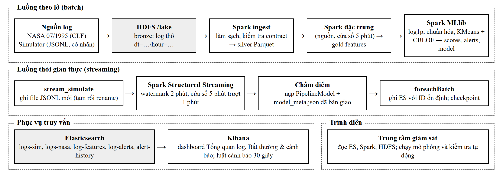

Các dịch vụ chạy trong Docker Compose được liệt kê ở Bảng 3.1. Spark job nào cũng được submit lên spark://spark-master:7077, nhóm không chạy local mode.

TABLE Bảng 3.1. Các dịch vụ của hệ thống
| Dịch vụ | Phiên bản | Vai trò | Cổng giao diện |
| Spark master, Spark worker | 3.5.8 | Chạy job ingest, đặc trưng, mô hình, streaming, worker có 4 lõi | 8080, 8081, 4040 |
| HDFS NameNode, DataNode | Hadoop 3.2.1 | Lưu data lake /lake | 9870 |
| Elasticsearch | 8.19.14 | Lưu log, đặc trưng, cảnh báo phục vụ truy vấn | 9200 |
| Kibana | 8.19.14 | Dashboard và luật cảnh báo | 5601 |
| Trung tâm giám sát | Python 3, thư viện chuẩn | Trang demo tiếng Việt | 8765 |

## 3.2 Thu thập và làm sạch dữ liệu

### 3.2.1 Log NASA

Log NASA được tải về bằng scripts/download_nasa.ps1 và để trong data/raw/nasa. Job ingest_nasa.py đọc log nén bằng regex CLF, đổi timestamp về UTC rồi ghi ra silver Parquet, tên cột được đặt giống với simulator là event_time, ip, method, path, status_code, bytes_out. Khi làm sạch thì nhóm quyết định như sau:

- Dòng nào không khớp CLF hoặc request không bắt đầu bằng HTTP method thì bị đưa vào silver/_rejected kèm theo lý do, chứ không xóa đi mà không báo.
- Request kiểu HTTP/0.9 bị thiếu protocol thì vẫn giữ, protocol để null.
- Request có dấu cách hoặc có rác trong đường dẫn thì vẫn giữ và gắn cờ request_inconsistent.
- Trường bytes bằng "-" thì được thay bằng 0 và gắn cờ bytes_missing, trường hợp này hay gặp ở các response 304 và 302 không có body.
- Dòng trùng hoàn toàn thì vẫn giữ lại, vì cùng một host gửi hai request thật trong cùng một giây là chuyện bình thường, nếu xóa đi thì số request và burst_rate sẽ bị sai. Số dòng trùng chỉ được đếm ra để báo cáo.

Kết quả là đọc được 1.891.715 dòng, ghi vào silver 1.891.709 dòng, loại 6 dòng gồm 5 request sai định dạng và 1 dòng bị cắt cụt. Có 835 dòng trùng được giữ lại, 19.721 dòng thiếu số byte được gắn cờ, 3.732 request HTTP/0.9 và 974 request có đường dẫn không nhất quán. Dữ liệu có khoảng 79.433 host khác nhau, con số này ước lượng bằng approx_count_distinct, thời gian từ 01/07/1995 04:00 đến 28/07/1995 17:32 UTC.

### 3.2.2 Log mô phỏng

generator/simulate.py sinh traffic bình thường theo phiên của người đọc bài viết, có mô phỏng cache HIT/MISS, sau đó chèn thêm bốn injector tấn công là brute_force, sqli, scan và ddos. Mọi chỗ ngẫu nhiên đều đi qua random.Random có nhận seed, nên cùng tham số thì lần nào cũng sinh ra đúng dữ liệu đó. Bộ dữ liệu đánh giá được sinh bằng lệnh python -m generator.simulate --minutes 1440 --rate 12 --attack-repeat 30 --start 2026-01-10T00:00:00Z --seed 42, nghĩa là 24 giờ traffic và mỗi kiểu tấn công lặp lại 30 lần để tập test có đủ mẫu.

Job ingest_http_access.py đọc JSONL bằng schema cố định, khử trùng theo trace_id, kiểm tra contract và đưa dòng lỗi vào silver/_rejected. Kết quả là 1.065.283 dòng được ingest vào silver, không có dòng trùng, không có JSON lỗi và không có dòng nào vi phạm contract.

Cả hai job ingest đều tắt partitionColumnTypeInference để hour=00 không bị đọc thành 0, và dùng partitionOverwriteMode=dynamic để khi chạy lại thì chỉ ghi đè đúng partition đó.

## 3.3 Lưu trữ trên HDFS

Luồng lưu trữ đi như sau: simulator JSONL → HDFS /lake/bronze/http_access → Spark ingest → HDFS /lake/silver/http_access → Spark export → Elasticsearch. Đường dẫn được truyền vào job qua tham số nên job chạy được cả trên thư mục local lẫn hdfs://namenode:9000/lake/.... Hình 3.2 là thư mục /lake trên giao diện NameNode, có các tầng raw, bronze, silver và gold.

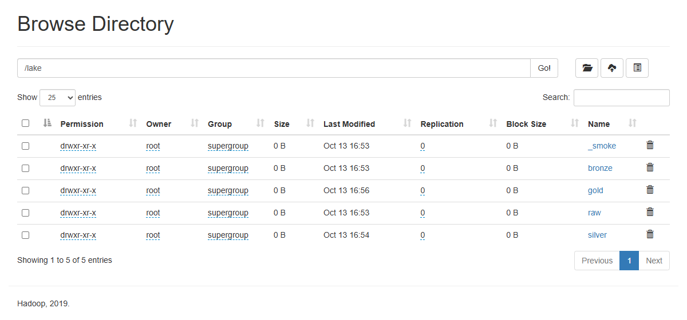

Cấu hình dfs.replication phải truyền ở phía Spark client. Nếu chỉ đặt replication=1 ở NameNode thì Hadoop client bên Spark vẫn dùng mặc định là 3. Script run_on_hdfs.ps1 có truyền spark.hadoop.dfs.replication=1 để cụm chỉ có một DataNode không bị báo thiếu replica.

Nhóm kiểm tra trên một bộ dữ liệu thử 61.643 record vào ngày 13/10/2026. Bản silver trên HDFS được so với bản local trên 16 trường contract cùng với event_time, dt, hour. Hai trường source_file và ingested_at thì bỏ qua vì hai lần ingest đương nhiên khác nhau. Kết quả là hai bản khớp nội dung, không có event_time bị null và cũng không có partition hour bị sai hai chữ số. Bronze JSONL chiếm 31.989.953 byte, còn silver Parquet chiếm 5.192.880 byte, nhỏ hơn khoảng 6,16 lần. Đây chỉ là so kích thước của cùng một bộ dữ liệu thử, không phải benchmark tổng quát.

## 3.4 Trích xuất đặc trưng bằng Spark

Job build_features.py đọc silver, gọi hàm build_window_features trong features_common.py rồi ghi ra gold/features_{source} theo partition ngày. Với simulator thì tính đủ 16 đặc trưng gồm cả CORE và EXTENDED, kèm theo nhãn tổng hợp của cửa sổ, còn NASA thì chỉ tính 11 CORE. Job có in ra số cửa sổ, số IP và phân vị p50, p95, p99 của từng đặc trưng, các phân vị này được dùng để đặt ngưỡng cho rule baseline.

Batch dùng cửa sổ 5 phút không chồng nhau. Streaming dùng cửa sổ 5 phút trượt 1 phút nhưng vẫn dùng cùng một hàm, nên số cửa sổ của hai luồng khác nhau nhưng đặc trưng thì được định nghĩa giống nhau. Số cửa sổ của từng nguồn được ghi ở mục 4.1.

## 3.5 Huấn luyện mô hình

Job detect_anomalies.py so sánh các phương pháp trên cùng một bảng đặc trưng:

- rule: là các ngưỡng viết tay gồm flood khi burst_rate ≥ 2 và n_req ≥ 20, scan khi ratio_404 ≥ 0,5 và n_distinct_paths ≥ 10, many_errors khi ratio_4xx ≥ 0,6 và n_req ≥ 10, suspicious_path khi ratio_sus_path ≥ 0,3. Đây là baseline kiểu người có kinh nghiệm tự đặt luật.
- KMeans, điểm là khoảng cách tới tâm cụm của chính điểm đó.
- KMeans với điểm CBLOF.
- BisectingKMeans là phân cụm chia đôi phân cấp [@spark_clustering], cũng dùng điểm CBLOF.
- Phương pháp phân cụm nào cũng chạy trên cả CORE và EXTENDED để xem các đặc trưng chỉ simulator mới có thì đóng góp được bao nhiêu.

Với simulator thì dữ liệu được chia theo thời gian, 70% thời gian đầu để train và 30% cuối để test, như vậy mô hình không nhìn thấy dữ liệu tương lai. Với NASA không có nhãn thì model fit trên toàn bộ dữ liệu rồi xuất ra danh sách các cửa sổ có điểm cao nhất kèm hồ sơ của từng cụm. Kết quả được ghi ra gold/scores_{source}, gold/alerts_{source} và data/reports/metrics_{source}.json, các script trong analysis/ thì vẽ hình vào data/reports/figures.

## 3.6 Phát hiện thời gian thực

Model triển khai là KMeans + CBLOF trên 11 CORE_FEATURES, train trên simulator, vì generator thời gian thực sinh ra log cùng dạng và cùng cơ chế traffic với nguồn này. Lệnh detect_anomalies.py --source sim lưu PipelineModel vào data/gold/models/kmeans_core và lưu metadata vào data/reports/model_meta.json, metadata gồm features, window, k, large_clusters, threshold, centers và mốc dữ liệu huấn luyện. File model của Spark được đánh dấu binary trong .gitattributes để khi checkout không bị hỏng checksum .crc.

Job stream_detect.py đọc JSON bằng schema cố định, parse event_time theo UTC, đặt watermark 2 phút rồi gom theo ip và cửa sổ 5 phút với bước trượt 1 phút. Trigger mặc định là 10 giây, còn thời gian một batch thực tế thì còn tùy vào tài nguyên và số trạng thái đang giữ. Pipeline được nạp một lần ở driver rồi transform trong foreachBatch, dùng cùng hàm add_distance_score với batch, nên điểm là khoảng cách CBLOF tới tâm cụm tham chiếu như (2.6).

Lúc nạp model thì job kiểm tra metadata có khớp hợp đồng không. Danh sách và thứ tự features phải đúng CORE_FEATURES, window là 5 phút, algo là kmeans, scoring là cblof, threshold phải dương, min_req_for_scoring bằng 3 và centers trong metadata phải khớp với tâm cụm trong model. Sai một điều kiện thôi là job dừng lại và báo lỗi rõ ràng, chứ không âm thầm chấm điểm sai. Nếu thiếu model thì chế độ auto sẽ chuyển sang rule_fallback, điểm chỉ là 0 hoặc 1 và ngưỡng là 0,5. rule_fallback gồm các rule ở mục 3.5 và thêm cache_busting_flood, rule này bắt khi n_req và n_distinct_paths ít nhất là 5, tỷ lệ MISS ít nhất 95%, tỷ lệ 5xx ít nhất 20% và mean_latency ít nhất 800 ms. Document cảnh báo nào cũng ghi rõ trường detector để biết điểm là do model hay do rule.

Sink dùng document ID cố định, là hash của source, ip và window_start. Khi Spark retry hoặc khởi động lại từ checkpoint thì cùng một cửa sổ sẽ được ghi đè vào cùng document chứ không thêm bản sao.

## 3.7 Đưa dữ liệu sang Elasticsearch

Job export_to_es.py dùng connector elasticsearch-spark-30 [@es_hadoop], bulk 2.000 document một lần, tạm tắt refresh_interval rồi khôi phục lại cấu hình trong khối finally. Các cột Vector của ML được bỏ ra khỏi document. Hai trường error_flag và cache_miss_flag để dạng số để có thể tính tỷ lệ lỗi và tỷ lệ cache MISS bằng phép average trong Lens. Các index và số document tính tới ngày 29/10/2026 được ghi ở Bảng 3.2.

TABLE Bảng 3.2. Các index Elasticsearch
| Index | Nội dung | Document ID | Số document |
| logs-sim | Log simulator đã làm sạch | trace_id | 1.065.283 |
| logs-nasa | Log NASA đã làm sạch | Hash nội dung cộng số thứ tự trong nhóm dòng giống nhau | 1.891.709 |
| log-features | Đặc trưng và điểm theo cửa sổ, có source và detector | Hash của source, ip, window_start | 598.537 |
| log-alerts | Cửa sổ vượt ngưỡng: score, threshold, severity, reason, detected_at, detector | Giống log-features | 5.275 |
| alert-history | Bằng chứng luật Kibana đã thực thi Index action | Do Kibana sinh | 6 |

ID của logs-nasa giữ được số lần lặp của các dòng trùng thật, nên export lại bao nhiêu lần thì vẫn ra đúng số document. Trên bộ dữ liệu thử 61.643 record, nhóm export logs-sim hai lần thì cả hai lần đều được 61.643 document. Lần đầu mất khoảng 12,6 giây, lần cập nhật mất khoảng 12,5 giây, thời gian này tính cả đọc Parquet, tạo document, ghi và refresh Elasticsearch.

## 3.8 Dashboard và cảnh báo

### 3.8.1 Dashboard thống kê lỗi

Dashboard "Tổng quan log" ở Hình 3.3 hiển thị số request, tỷ lệ lỗi HTTP, số IP khác nhau, số cửa sổ bất thường, request theo thời gian tách theo mã trạng thái, phân bố mã trạng thái, các IP bị lỗi 4xx nhiều nhất, các đường dẫn trả 404 nhiều nhất, tỷ lệ cache MISS và độ trễ p95. Hai panel cuối chỉ có số liệu với log mô phỏng nên khi xem log NASA sẽ hiện N/A. Time range mặc định được lấy theo khoảng thời gian của dữ liệu batch, để log cũ không bị ẩn mất khi để "Last 15 minutes".

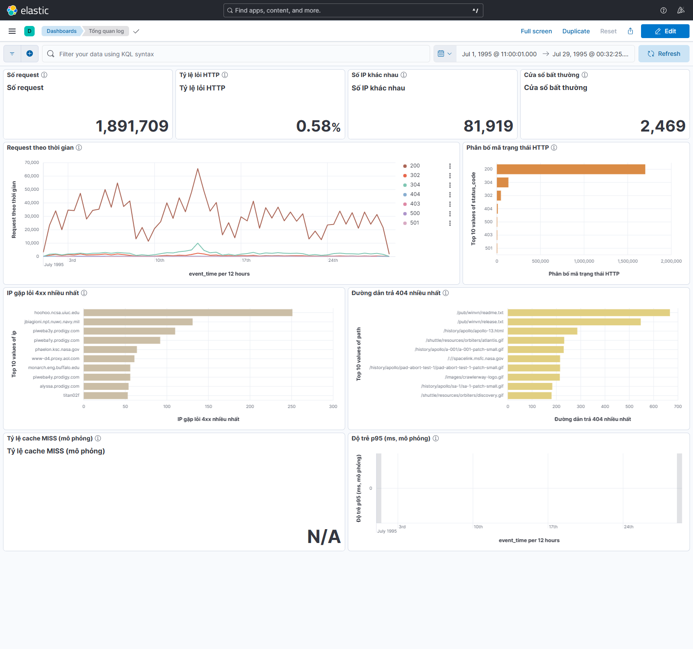

Trên log NASA thì dashboard ra 1.891.709 request, tỷ lệ lỗi là 0,58% và có 81.919 IP khác nhau. Số IP này khác với con số 79.433 ở mục 3.2.1 là vì cả hai đều là đếm xấp xỉ, Spark dùng approx_count_distinct còn Kibana dùng aggregation cardinality của Elasticsearch, hai cách có sai số khác nhau.

### 3.8.2 Dashboard bất thường và luật cảnh báo

Dashboard "Bất thường & cảnh báo" ở Hình 3.4 hiển thị số cửa sổ bất thường, số IP bị cảnh báo, số lần luật cảnh báo kích hoạt, bảng các cửa sổ bất thường mới nhất, đường điểm so với ngưỡng, phân bố cụm KMeans, nhãn mô phỏng so với dự đoán và lý do cảnh báo. Auto-refresh để 10 giây. Hình 3.4 được chụp đúng khoảng thời gian của lần kiểm thử DDoS thứ hai ngày 29/10. Trong hình thì các cửa sổ thuộc cụm nhỏ 1 và được so với cụm lớn 0, các dòng đầu có điểm từ 18 đến 21 trong khi ngưỡng là 7,493, và top_feature là burst_rate.

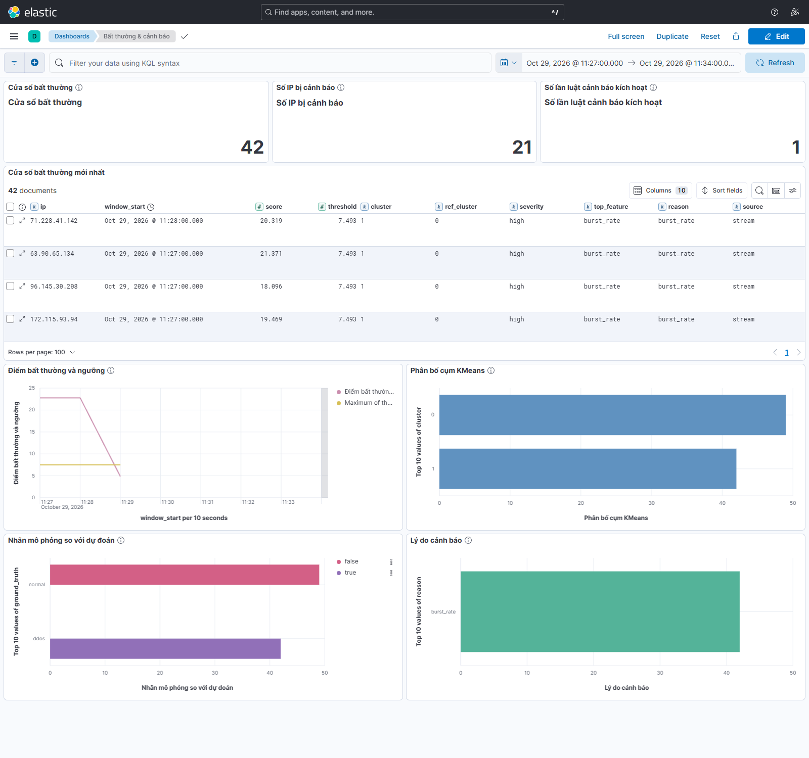

Luật cảnh báo loại Elasticsearch query chạy 30 giây một lần, kiểm tra log-alerts theo detected_at trong một phút gần nhất với điều kiện count > 0. Luật dùng Server log action và Index action để ghi vào alert-history. Action chỉ chạy khi trạng thái chuyển sang nhóm cảnh báo, như vậy nếu trạng thái vẫn còn active thì mỗi lần chạy theo lịch sẽ không ghi lặp lại. Saved objects của hai dashboard nằm trong kibana/dashboards.ndjson, nhóm đã import thử vào một Kibana space mới thì ra đủ 2 dashboard và 18 tham chiếu panel. Connector và luật được tạo lại bằng API, nhóm không đưa secret vào file NDJSON.

### 3.8.3 Trang Trung tâm giám sát

Để demo trước hội đồng thì nhóm làm thêm một trang tiếng Việt tên là LogSentinel, chạy ở địa chỉ 127.0.0.1:8765, mở bằng lệnh python -m console.server. Bên trái trang là thanh điều hướng tới năm phần là Tổng quan hạ tầng, Mô phỏng tấn công, Cảnh báo, Kiểm tra tự động và Dashboard Kibana. Phía trên cùng có bốn thẻ tổng quan gồm số dịch vụ đang kết nối, tổng số bản ghi trong Elasticsearch, số lõi CPU đang dùng trên tổng số lõi và dung lượng đã dùng trên HDFS, bên dưới là dải luồng xử lý đi từ HTTP logs qua HDFS, Spark và KMeans, Elasticsearch rồi tới cảnh báo, như ở Hình 3.5.

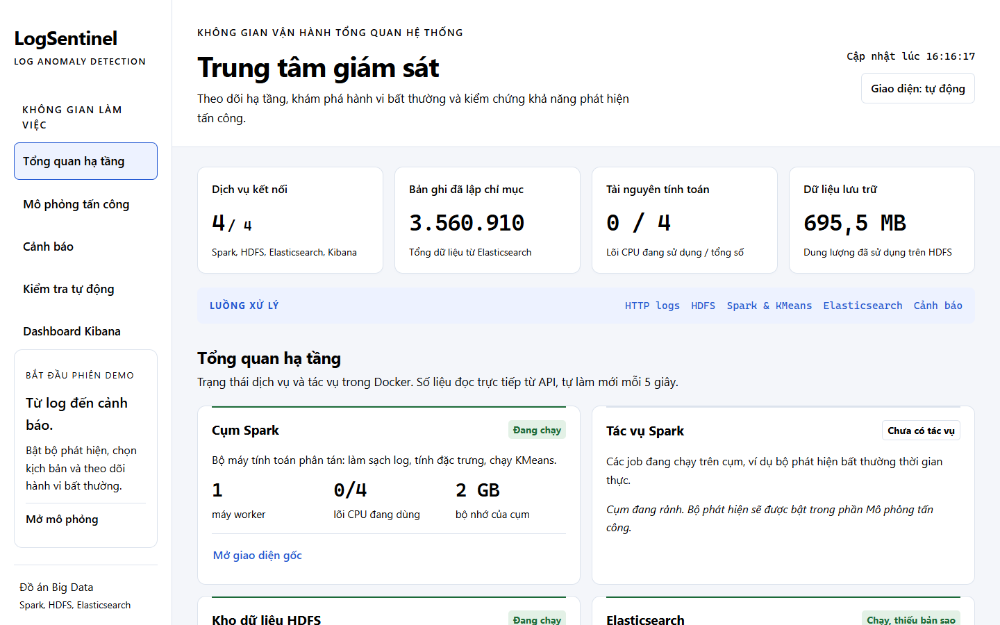

Trang này chỉ đọc kết quả của các phần ở trên, gồm trạng thái của Spark, HDFS, Elasticsearch và Kibana lấy qua API của từng dịch vụ, các cảnh báo trong log-alerts và dashboard Kibana được nhúng vào. Trang cũng gọi generator.stream_simulate và scripts/verify_realtime.py như lệnh bên ngoài, có khóa để mỗi lúc chỉ chạy một việc vì worker chỉ có 4 lõi.

Mỗi cảnh báo được dịch ra câu tiếng Việt dựa vào top_feature và các đặc trưng của cửa sổ, có kèm điểm và ngưỡng, như ở Hình 3.6. Nhãn mô phỏng chỉ hiện ra để đối chiếu, model không dùng nhãn này.

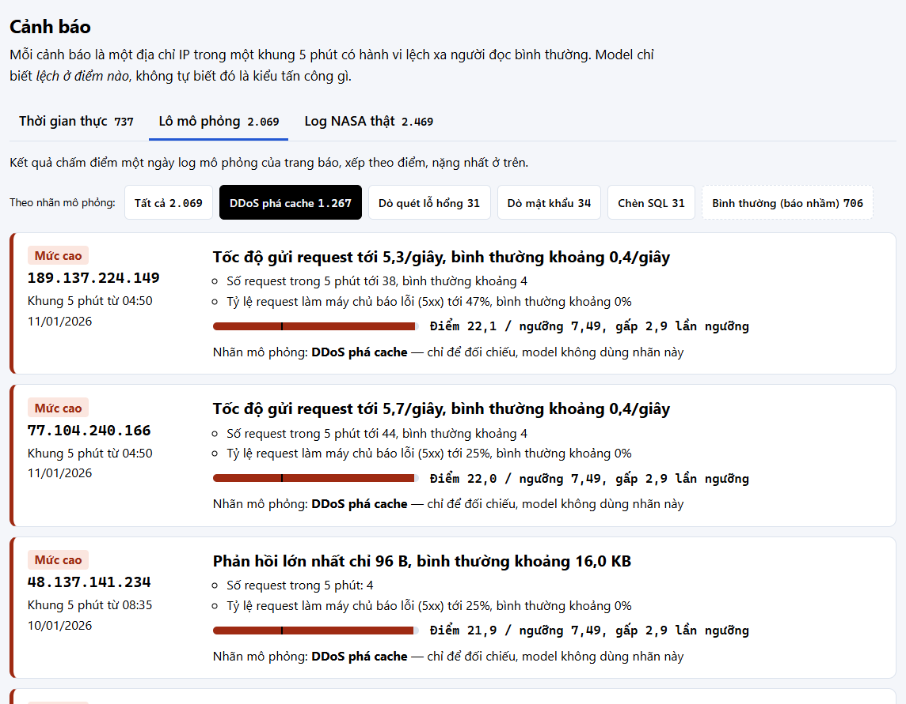

# CHƯƠNG 4. THỰC NGHIỆM VÀ ĐÁNH GIÁ KẾT QUẢ

## 4.1 Đặc điểm dữ liệu thực nghiệm

Mục này tóm tắt lại dữ liệu sau các bước làm sạch và trích xuất đặc trưng ở Chương 3, làm cơ sở cho các kết quả đánh giá ở mục 4.2 đến 4.4.

Với log NASA thì phân bố mã trạng thái được ghi ở Bảng 4.1 và Hình 4.1, mã 200 chiếm khoảng 90%, còn lỗi 4xx và 5xx thì rất ít. Phương thức gần như toàn là GET với 1.887.646 dòng, HEAD có 3.952 dòng và POST có 111 dòng. Hình 4.2 cho thấy lượng request lên xuống theo giờ trong ngày.

TABLE Bảng 4.1. Phân bố mã trạng thái của log NASA sau làm sạch
| Mã trạng thái | Số dòng |
| 200 | 1.701.534 |
| 304 | 132.627 |
| 302 | 46.573 |
| 404 | 10.845 |
| 500 | 62 |
| 403 | 54 |
| 501 | 14 |

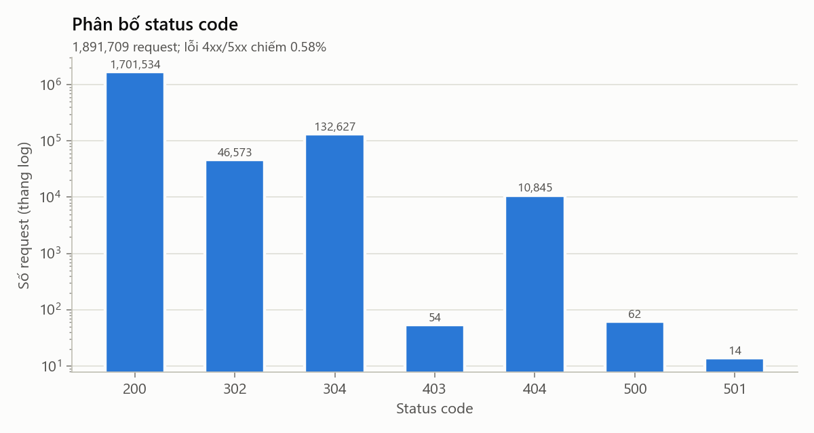

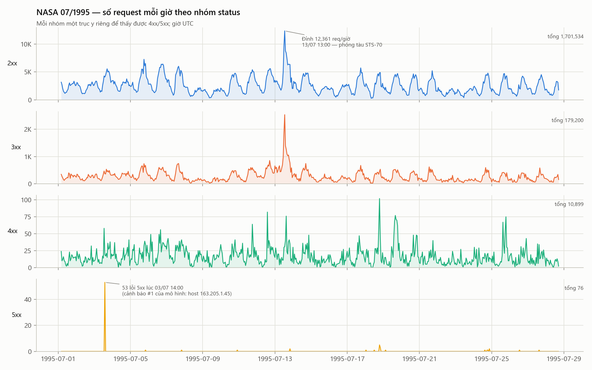

Bảng 4.2 ghi số cửa sổ đặc trưng của từng nguồn. Trong simulator chỉ có khoảng 0,6% cửa sổ có tấn công nên dữ liệu đánh giá bị mất cân bằng nhiều, vì vậy nhóm dùng precision, recall, F1 và PR-AUC chứ không dùng accuracy.

TABLE Bảng 4.2. Số cửa sổ đặc trưng
| Nguồn | Số cửa sổ | Ghi chú |
| Simulator | 238.295 từ 109.035 IP | 236.901 bình thường, 1.297 ddos, 34 brute_force, 31 scan, 32 sqli, khoảng 0,6% có tấn công |
| Simulator, tập train | 167.215 | Trước mốc 2026-01-10 16:48 UTC |
| Simulator, tập test | 71.080 | Sau mốc trên |
| NASA | 358.687 | Số cặp host và cửa sổ 5 phút, không phải số host hay số request |

## 4.2 Kết quả trên tập test mô phỏng

Silhouette chọn k = 2 với giá trị 0,3656, cao nhất trong khoảng từ 2 đến 10, như ở Hình 4.3. Cụm 0 là cụm lớn với 121.608 cửa sổ train, cụm 1 là cụm nhỏ với 796 cửa sổ. Ngưỡng triển khai là θ = 7,4929.

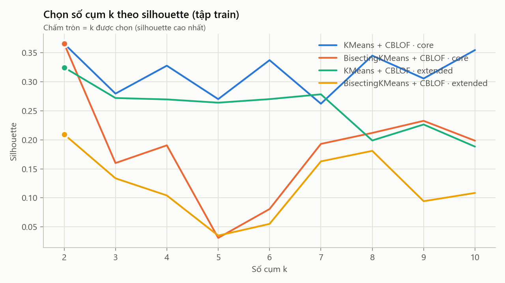

Bảng 4.3 so sánh các phương pháp ở cấp cửa sổ, ngưỡng được lấy từ tập train và không dùng nhãn.

TABLE Bảng 4.3. So sánh phương pháp trên tập test simulator
| Phương pháp | Precision | Recall | F1 | PR-AUC | FPR | Recall ddos |
| Rule ngưỡng | 1,000 | 0,368 | 0,538 | – | 0,000 | 0,337 |
| KMeans, tâm cụm riêng, CORE | 0,221 | 0,211 | 0,216 | 0,157 | 0,006 | 0,172 |
| KMeans + CBLOF, CORE, bản triển khai | 0,720 | 0,998 | 0,836 | 0,998 | 0,003 | 1,000 |
| BisectingKMeans + CBLOF, CORE | 0,752 | 0,998 | 0,858 | 0,998 | 0,003 | 1,000 |
| KMeans + CBLOF, EXTENDED | 0,751 | 0,998 | 0,857 | 0,998 | 0,003 | 1,000 |
| BisectingKMeans + CBLOF, EXTENDED | 0,736 | 0,998 | 0,848 | 0,998 | 0,003 | 1,000 |

Hình 4.4 vẽ lại bốn độ đo của Bảng 4.3 thành dạng cột cho dễ so sánh.

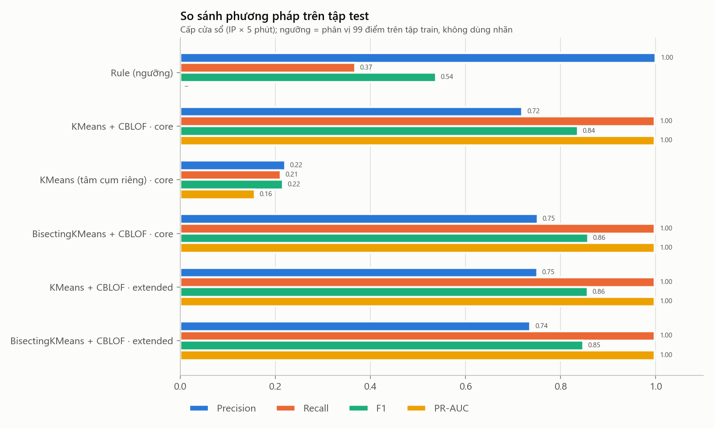

Rule thì không báo nhầm nhưng bỏ sót 2/3 số cửa sổ DDoS, vì mỗi IP DDoS chỉ gửi ít request nên không tới được ngưỡng flood. Ma trận nhầm lẫn của model triển khai là 567 TP, 221 FP, 1 FN và 70.291 TN. Nói cách khác thì model tìm ra được 567 trong 568 cửa sổ có tấn công, nhưng trong 788 cửa sổ đã báo thì có 221 cửa sổ là báo nhầm. Recall theo từng loại thì brute_force, ddos, scan đều là 1,0, còn sqli là 0,9, như ở Hình 4.5.

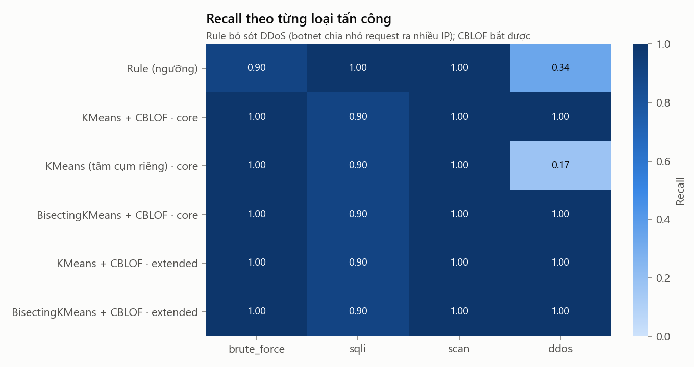

Kết quả thấy rõ nhất là khi chuyển từ khoảng cách tới tâm riêng sang CBLOF thì F1 tăng từ 0,216 lên 0,836. Hình 4.6 cho thấy lý do là các cửa sổ tấn công tự gom lại thành một cụm nhỏ nằm xa cụm lớn, nên nếu so với tâm của chính cụm đó thì chúng lại trông bình thường.

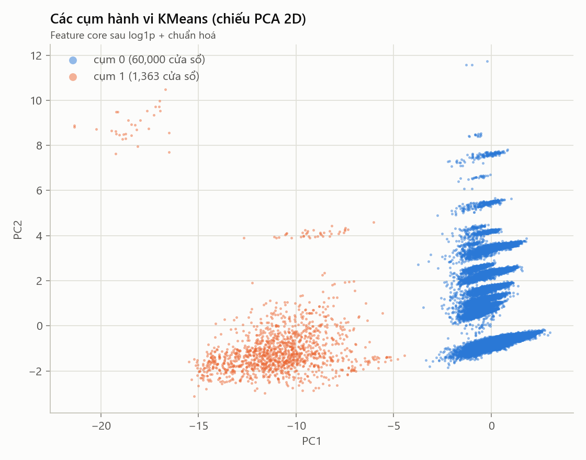

BisectingKMeans CORE có F1 cao hơn KMeans CORE khoảng 0,02. Nhóm vẫn chốt KMeans CORE làm model triển khai vì mấy lý do. Hai phương pháp có recall bằng nhau, F1 chênh nhau ít trên một bộ simulator thì chưa đủ để đổi model đã tích hợp xong với streaming, và KMeans phân cụm phẳng nên dễ giải thích hơn. Đây là lựa chọn để triển khai, nhóm không khẳng định KMeans là tốt nhất. EXTENDED chỉ nhỉnh hơn CORE một chút, cho thấy 11 đặc trưng chung đã mang phần lớn tín hiệu rồi. Hình 4.7 là đường precision–recall của model triển khai. Lúc vẽ hình này thì cửa sổ bình thường có được lấy mẫu, nên precision trên hình chỉ để minh họa hình dạng đường cong, không dùng thay cho số ở Bảng 4.3.

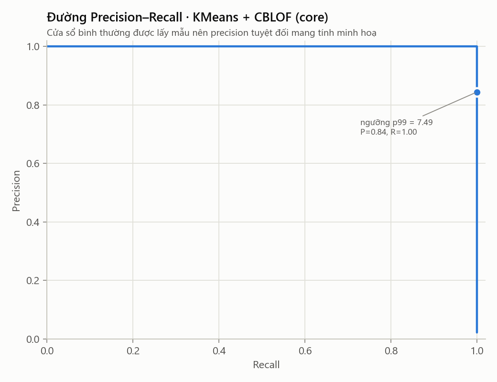

Nếu tìm ngưỡng tốt nhất trên chính tập test thì F1 được khoảng 0,999, nhưng ngưỡng đó có dùng nhãn test nên chỉ để tham khảo, không phải là kết quả triển khai.

## 4.3 Kết quả trên log NASA

Silhouette chọn k = 3 cho KMeans CORE. Cụm 0 có 199.002 cửa sổ và cụm 2 có 39.667 cửa sổ là hai cụm lớn. Cụm 1 chỉ có 1.215 cửa sổ với tỷ lệ 404 trung bình là 0,532, tức là một nhóm nhỏ toàn bị lỗi không tìm thấy. Ngưỡng p99 là 6,2966 và có 2.487 trong 358.687 cửa sổ vượt ngưỡng, khoảng 0,69%.

Cửa sổ có điểm cao nhất là của host 163.205.1.45 lúc 14:50 ngày 03/07, có 35 request, đặc trưng nổi bật là ratio_5xx. Host này còn xuất hiện ở các cửa sổ liền kề là 14:40, 14:45 và 14:55. Xếp sau là các cửa sổ có ratio_sus_path cao của piweba4y.prodigy.com và sun1.who.ch, rồi tới các cửa sổ có POST, vốn rất hiếm trên một site gần như chỉ có GET, như ở Hình 4.8.

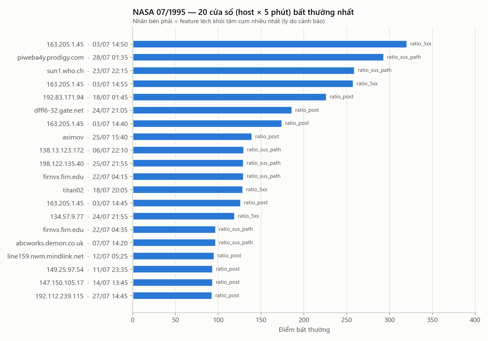

Trên máy demo thì job score_demo_batch.py fit lại KMeans NASA với cùng k = 3 để có dữ liệu cho dashboard. Lần chạy ngày 14/10 ra 2.423 cửa sổ cảnh báo, lần chạy ngày 29/10 ra 2.469 cửa sổ, đây là số đang hiện trên Kibana ở Hình 3.3. Fit lại thì chưa ra đúng y từng cửa sổ giữa các lần chạy, nên khi trình bày phải nói rõ con số là của lần chạy nào. Ngưỡng của NASA và ngưỡng của simulator là hai ngưỡng riêng, không dùng chung.

NASA không có nhãn tấn công nên nguồn này không có precision và recall. Các cửa sổ bị đánh dấu chỉ là đầu mối để người vận hành vào điều tra, chứ không phải là xác nhận có tấn công.

## 4.4 Kết quả kiểm thử thời gian thực

Script scripts/verify_realtime.py chạy simulator thời gian thực với một kịch bản, chờ tới khi có cảnh báo đầu tiên trong Elasticsearch, sau đó khởi động lại job từ checkpoint rồi đếm lại số document để kiểm tra có bị ghi trùng không. Độ trễ được đo từ timestamp của request tấn công đầu tiên cho tới lúc chương trình polling thấy cảnh báo trong Elasticsearch. Kịch bản bình thường chạy 180 giây không có tấn công và chỉ cho phép tối đa 2 cửa sổ cảnh báo. Bảng 4.4 ghi lại các lần chạy đã lưu kết quả.

TABLE Bảng 4.4. Kết quả kiểm thử thời gian thực
| Ngày | Bộ phát hiện | Kịch bản | Kết quả |
| 13/10/2026 | rule_fallback | DDoS, 21 IP | Cảnh báo đầu sau 18,330 giây, có 105 cửa sổ và sau restart vẫn là 105, luật Kibana có ghi lịch sử. Đạt |
| 13/10/2026 | rule_fallback | Scan, 1 IP | Cảnh báo đầu sau 12,295 giây, có 5 cửa sổ và sau restart vẫn là 5. Đạt |
| 13/10/2026 | rule_fallback | Bình thường, 180 giây, 352 record | 0 cửa sổ cảnh báo. Đạt |
| 29/10/2026 | kmeans_cblof | DDoS, chạy 2 lần | Cảnh báo đầu sau 18,317 và 18,318 giây, có 105 cửa sổ và sau restart vẫn là 105. Đạt |
| 29/10/2026 | kmeans_cblof | Bình thường, 180 giây | 6 cửa sổ cảnh báo, vượt mức cho phép là 2. Không đạt |

Với model thì DDoS phân tán được phát hiện với độ trễ gần bằng rule. Nhưng ngược lại thì traffic bình thường bị báo nhầm 6 cửa sổ trong 3 phút. Điều này cũng khớp với kết quả batch ở mục 4.2, ở đó có khoảng 28% cảnh báo là báo nhầm. Nhóm chưa phân tích từng cửa sổ báo nhầm này. Nhóm nghĩ một nguyên nhân có thể là ngưỡng p99 được đặt trên cửa sổ không chồng, còn streaming lại dùng cửa sổ trượt nên một hành vi lạ có thể xuất hiện ở nhiều cửa sổ liền nhau. Kịch bản scan với model thì chưa có lần chạy nào hoàn chỉnh. Các số đo trên là quan sát trên một máy, nhóm không chắc lần chạy nào cũng ra đúng con số này.

Một IP có thể nằm trong nhiều cửa sổ trượt, vì vậy 105 document cảnh báo không có nghĩa là có 105 cuộc tấn công khác nhau.

# CHƯƠNG 5. KẾT LUẬN VÀ HƯỚNG PHÁT TRIỂN

## 5.1 Kết quả đạt được

- Làm được pipeline bronze → silver → gold trên Spark standalone và HDFS, xử lý 1.891.715 dòng log NASA và 1.065.283 dòng log mô phỏng.
- Có 11 đặc trưng theo cửa sổ 5 phút dùng chung cho batch và streaming.
- Model KMeans + CBLOF trên tập test mô phỏng được precision 0,720, recall 0,998, F1 0,836 và PR-AUC 0,998. So với cách lấy khoảng cách tới tâm riêng thì CBLOF nâng F1 từ 0,216 lên 0,836.
- Streaming dùng model đã bàn giao, phát hiện DDoS sau khoảng 18,3 giây và không bị ghi trùng sau khi khởi động lại.
- Có năm index Elasticsearch, hai dashboard Kibana, luật cảnh báo có ghi lịch sử thực thi, và một trang demo tiếng Việt.

## 5.2 Hạn chế

Simulator là do nhóm tự viết nên tấn công có dấu hiệu rõ, dễ tách hơn so với traffic thật, F1 0,836 chỉ có ý nghĩa trên bộ dữ liệu này thôi. NASA thì không có nhãn nên nhóm chưa đánh giá ra số liệu được trên log thật. Precision 0,72 nghĩa là khoảng 28% cảnh báo là báo nhầm, và bài kiểm thử traffic bình thường với model ở streaming cũng chưa đạt vì có 6 cửa sổ báo nhầm trong 3 phút. Nếu nâng ngưỡng lên thì sẽ ít báo nhầm hơn nhưng có thể bị bỏ sót.

Gom theo IP thì bỏ qua trường hợp nhiều người dùng chung một IP qua NAT hoặc proxy. DDoS phân tán mà mỗi IP chỉ có rất ít request thì có thể rơi xuống dưới mức 3 request và bị gán điểm 0. Việc thay bytes thiếu bằng 0 có thể làm lệch mean_bytes và max_bytes trên NASA. Trên NASA còn có các đặc trưng gần như lúc nào cũng bằng 0 như ratio_5xx, ratio_post, ratio_sus_path nên độ lệch chuẩn rất nhỏ. Sau khi qua StandardScaler thì một cửa sổ hiếm hoi khác 0 sẽ bị khuếch đại lên thành điểm hàng trăm, vì vậy thứ hạng top cảnh báo NASA nghiêng về sự kiện hiếm hơn là sự kiện nghiêm trọng. Cụm lớn được giả định là hành vi bình thường, nếu tấn công phổ biến tới mức thành cụm lớn thì giả định này sẽ sai.

Hệ thống chỉ chạy một worker, một DataNode và một node Elasticsearch nên chưa chứng minh được khả năng mở rộng hay chịu lỗi khi mất node. Fit lại KMeans NASA trên máy demo thì kết quả vẫn còn chênh vài chục cửa sổ giữa các lần chạy.

## 5.3 Hướng phát triển

- Đánh giá trên log web hiện đại có nhãn và phân tích kỹ từng cảnh báo nhầm.
- Đặt ngưỡng riêng cho cửa sổ trượt của streaming, hoặc gộp các cửa sổ liền nhau của cùng một IP thành một sự kiện.
- Thêm đặc trưng tổng hợp cho toàn hệ thống để bắt được DDoS phân tán.
- So sánh thêm với Isolation Forest [@liu2008] hoặc autoencoder.
- Thêm worker và DataNode, dùng Kafka làm nguồn log, chạy benchmark cùng một job trên nhiều kích thước dữ liệu và số worker khác nhau.
- Bật bảo mật kết nối cho Elasticsearch và Kibana trước khi đem ra dùng ngoài môi trường học tập.

#* TÀI LIỆU THAM KHẢO

::refs

#* PHỤ LỤC. HƯỚNG DẪN CÀI ĐẶT VÀ CHẠY

Các lệnh dưới đây chạy từ thư mục gốc của repository, trên Windows thì dùng PowerShell.

- Dựng môi trường: cp .env.example .env, đặt KIBANA_ENCRYPTION_KEY, rồi docker compose up -d --build.
- Tải NASA: powershell -File scripts/download_nasa.ps1, nếu dùng Linux thì chạy sh scripts/download_nasa.sh.
- Sinh simulator: python -m generator.simulate --minutes 1440 --rate 12 --attack-repeat 30 --start 2026-01-10T00:00:00Z --seed 42.
- Ingest: .\scripts\submit.ps1 ingest_nasa.py và .\scripts\submit.ps1 ingest_http_access.py.
- Đặc trưng: .\scripts\submit.ps1 build_features.py --source sim, rồi chạy lại với --source nasa.
- Mô hình: .\scripts\submit.ps1 detect_anomalies.py --source sim để train, đánh giá và lưu model cho streaming, rồi chạy tiếp với --source nasa.
- Chuẩn bị đủ batch và serving cho demo: powershell -File scripts/run_all.ps1 -Batch -Serve -Hdfs.
- Streaming: .\scripts\submit.ps1 stream_detect.py, thêm --detector model nếu muốn bắt buộc dùng model, thiếu artifact thì sẽ báo lỗi.
- Sinh traffic thời gian thực: python -m generator.stream_simulate --attack ddos --attack-after 20 --duration 120.
- Kiểm thử thời gian thực: python scripts/verify_realtime.py --attack ddos, có thể đổi ddos thành scan hoặc none, mỗi lần chạy dùng thư mục và checkpoint riêng.
- Import dashboard: scripts/kibana_import.ps1.
- Trung tâm giám sát: python -m console.server, mở http://127.0.0.1:8765.
- Kiểm tra HDFS: docker compose exec namenode hdfs dfs -ls -R /lake, hdfs dfsadmin -report, hdfs fsck /lake -files -blocks.
- Giao diện: Spark 8080, HDFS 9870, Elasticsearch 9200, Kibana 5601.
- Kết quả batch nằm ở data/reports gồm dq_nasa.json, metrics_sim.json, metrics_nasa.json, model_comparison.md, model_meta.json và thư mục figures.
